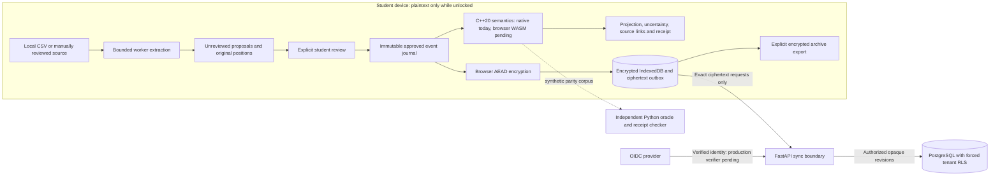
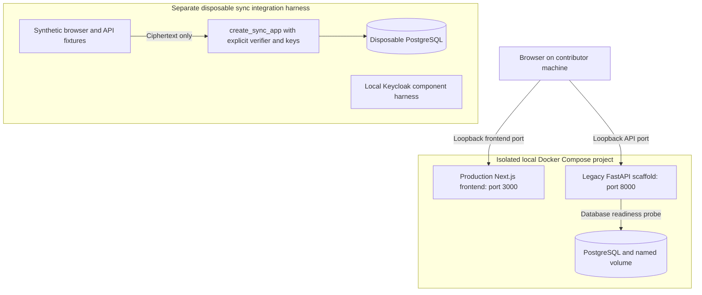
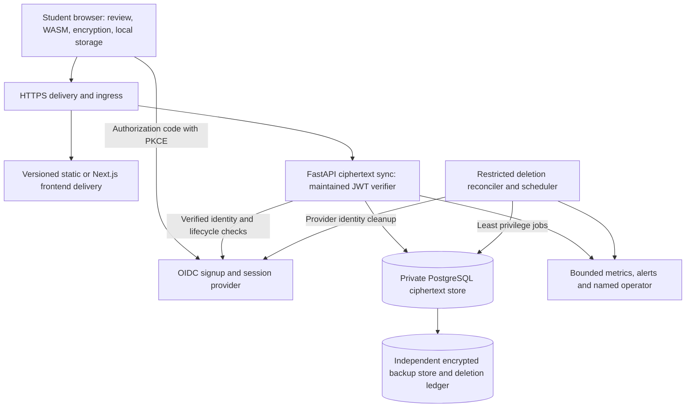

# Scryer

**Understand a student-aid money trail from the records that support it.**

Scryer helps a student compare an aid offer, school-account postings, a refund notice and an observed bank deposit. It keeps the records, reviewed interpretations and exact calculation steps together so the student can ask a precise question about a discrepancy. It does not decide aid eligibility, establish a legal entitlement, authenticate a document or determine an amount a school owes.

> [!WARNING]
> **Pre-alpha: use synthetic records only.** The current browser workspace previews proposed bank CSV entries. It cannot approve, calculate from, save, recover or sync a personal case. Public accounts and real financial records are blocked by the release gates below.

This README is the repository's single human-readable contract. Machine-readable contracts, examples, journeys and acceptance evidence remain JSON/YAML. The detailed documents that preceded this layout can be read from Git history at `02252f6`; their implementation-status paragraphs are historical observations, not current release evidence.

## Product and release contract

The primary user is a student reconciling their own aid records, initially for the University of Maryland context. Parent and third-party aid recipients must remain explicit. The core question is: **What do these reviewed records support, why did that amount change, and which evidence is still missing?** A source observation, a user approval and an institution-authenticated fact are different claims.

The target remains **public self-service signup and use with real student records by December 31, 2026, with $0 required cash hosting expenditure**. The synthetic demo is a current deliverable and a safe evaluation path; completing it does not satisfy that target. Missing release gates mean the target has not been achieved. They do not redefine the release as a demo.

| Capability | Current checkout | Observable target for December 31 |
| --- | --- | --- |
| Account-free evaluation | Landing page and fictional `/demo` with reproducible native-engine output | A public, accessible synthetic example requiring no account or records |
| Personal case | `/workspace` extracts unreviewed generic bank CSV proposals in a browser worker | A student can create/unlock a case, review an import, correct a fact, inspect a source-linked result and retain it after reload |
| Supported evidence | Generic bank CSV proposals; headless reviewed/manual commands; synthetic school/aid/refund fixtures | Documented, tested UMD aid, school bill and refund formats, generic bank CSV and clearly labeled reviewed manual fallback; unsupported layouts stop safely |
| Financial semantics | C++20 native engine and independent Python oracle | The same C++ semantics in the browser through WebAssembly, with release-corpus parity and explicit uncertainty |
| Local storage/recovery | Headless encrypted IndexedDB, archives, recovery and failure tests | A visible encrypted save/unlock/export/restore flow with recovery re-entry and loss explanations |
| Accounts and sync | Opaque FastAPI/PostgreSQL components; fixture verifiers in API tests; separate local OIDC component tests | Public signup/session lifecycle, maintained JWT verification, real-token isolation, stale-conflict review, quotas and account deletion in the deployed flow |
| Operations | Local scaffold and reproducible checks; hosted operation unestablished | A named operator, $0 cash capacity and independent backup arrangement, measured capacity, restore/deletion/incident and rollback rehearsals |
| Human evidence | Local synthetic automation and design artifacts | Actual maintainer review, two recorded outsider usability sessions, human screen-reader work, a consented real-record pilot under approved privacy procedures and independent security review |

The launch decision remains **no-go for public accounts and real records** until every public-release gate has evidence for the release revision. No local test, merged UI PR or native coverage measurement changes that decision by itself.

The former monthly-budget direction in issues #33–#36 is superseded by the user-approved aid-evidence product. There is no implemented monthly income/expense budget, spending allowance, net-worth estimator, transfer classifier or category dashboard. Team adoption of the corresponding issue-acceptance changes must be recorded through normal review; the [acceptance inventory](docs/foundation/acceptance.json) preserves the original questions and the pending adoption checks. The older `S-01`–`S-78` inventory is a separate historical backend assignment and is not a numbering scheme for GitHub #32–#40.

### Complete target journey

1. Explore the synthetic example, then choose a local case or optional account sync. Explain the plaintext boundary and recovery consequences before asking for a file.
2. Create or unlock encryption keys. Verify recovery-secret re-entry before the first durable save. Login recovery and financial-data recovery have distinct consequences.
3. Select a local source and its account. Detect format, bound parsing and map columns. Show unknown format, bad dates/amounts, partial periods and possible duplicates with a safe manual or cancel path.
4. Review every proposed interpretation with its source position. Approve, edit, reject or exclude deliberately. Unreviewed rows have no financial effect. Identical-looking legitimate transactions can both exist; equality of amount/date is not a duplicate identity.
5. Commit reviewed facts to the immutable journal and encrypted local repository atomically. Explain school surplus, aid lifecycle, refund issuance, candidate deposits and exact coverage gaps with source traversal.
6. Correct a fact by appending a reviewed replacement or cancellation. Show the before/after contribution and retain the original. Preserve divergent branches until explicit resolution.
7. Optionally sync ciphertext. Keep a local edit and prepared outbox on network failure, expired login, size/quota refusal or stale revision. Review local/remote evidence in the browser before any supported merge.
8. Export a verified encrypted archive, preview and restore it safely, or delete a local case, synced case or account with the different retention effects explained.

The [journey graph](docs/foundation/journeys.json), [navigable synthetic prototype](docs/foundation/prototype.html) and [usability protocol](docs/foundation/usability-sessions.json) cover successes, empty states, failures and recovery. The prototype is a design artifact. It does not implement accounts, financial validation or durable case operations. Two outsider sessions and the team's adoption are pending; automated navigation cannot stand in for either.

## Try the current browser app

Use Node.js **24** (also recorded in `.node-version`), npm, Python **3.12** and a C++20 compiler. Both npm packages declare Node 24 or newer; the headless client tests use Node's TypeScript stripping. Locked Python installation is described below.

```sh
npm --prefix client ci
npm --prefix frontend ci
npm --prefix frontend run dev
```

Open [http://localhost:3000](http://localhost:3000).

| Path | Behavior today |
| --- | --- |
| `/demo` | A complete fictional explanation with reviewed source links, exact changes and a native-generated receipt |
| `/workspace` | A local worker parses a synthetic generic bank CSV and displays unreviewed entries, warnings, original row fields and source positions |

For the CSV preview, use `YYYY-MM-DD`, a file of at most 20 MiB and exact header names, including spaces. Signed amounts and separate credit/debit columns are supported. PDFs require reviewed manual handling; this screen does not parse them. The preview is paginated and does not send the file to Scryer's API or write it to browser storage. It stops at extraction proposal.

The demo begins with $6,500 reviewed school credits and $5,000 charges: $1,500 surplus in that source set. A $300 grant correction and a separate $300 charge reduce it to $900. A refund notice and bank credit are separate observations. A receipt reproduces the calculation from approved fictional facts; it cannot prove the documents are authentic or complete.

## Architecture and data flow

The approved local event journal is the source of financial meaning. The C++ engine is a deterministic semantic boundary; it has no database, identity-provider or network responsibility. Python computes independently for comparison and receipt verification. Browser TypeScript owns import adapters, reviewed commands, encryption, storage and optional sync. FastAPI owns authenticated opaque transport and PostgreSQL owns durable ciphertext and account lifecycle.



The complete arrow chain is the design. Today the visible workspace reaches proposals; later browser components are headless and tested with synthetic semantic-validator callbacks. Those callbacks do not establish a released browser engine. The native engine already implements the semantic operations described below.

### Local deployment



The Compose API entrypoint is `main:app`, a local health/readiness scaffold. It is **not** `create_sync_app` and does not provide hosted accounts or encrypted sync. The separate database/API/browser integration harness exercises sync with explicit synthetic identity fixtures. Local OIDC tests do not imply that a maintained real-token verifier is wired into the API.

### Target public deployment



This diagram is a deployment contract, not a selected or provisioned host. No hosting account, production domain, backup provider or capacity guarantee is established by this checkout. The operations lead must document the free/donated capacity, renewal and expiry conditions, egress/build/storage limits, operator time and an independent backup destination before claiming $0 cash operation. Crossing a free limit must fail safely or trigger an approved plan; it must not create an unapproved bill. The release must rehearse restoration, deletion replay and rollback on the actual arrangement.

## Typed boundaries and versioning

| Boundary | Input and output | Authority and failure behavior |
| --- | --- | --- |
| Browser import worker | Versioned `ImportWorkerRequest`/`ImportWorkerResponse`; bounded source bytes, mapping and account metadata → proposals/candidates or stable error code | Extraction only; never auto-approve. Raw source values and row positions stay available for review. |
| Reviewed browser command | `ReviewDecision`/manual command + base head + unique review/operation IDs → new `CaseV1` and `ImportLedger` | Revalidate complete case, detect stale base and keep proposal distinct from interpretation. |
| Semantic engine | `scryer::evaluate(const Request&) -> Response`, owning parsed JSON | C++20 owns production rules; exact request fields, explicit version and typed errors. No successful placeholder for an unsupported operation. |
| Independent reference | Python `Case` and explicit heads → immutable dataclass results; independent receipt checker | An oracle and test tool, not a deployed browser implementation or a second production schema owner. |
| Encrypted local repository | Reviewed `StoredCaseV1` + expected local revision → authenticated package, anchor and saved ciphertext outbox | Atomic IndexedDB commit; stale/aborted/quota failures retain prior case. Semantic validator is required. |
| Sync API | Strict Pydantic/OpenAPI envelopes and exact canonical ciphertext wire bytes → opaque receipts, ETags or `{error:{code,requestId}}` | Verified identity selects tenant; a supplied account ID cannot select it. Financial plaintext is outside the API contract. |
| PostgreSQL | Checked SQL migrations, transactional store calls and signed tenant context | Durability, CAS, quotas, forced RLS and irreversible lifecycle boundaries; migrations run as a separate administrative identity. |

The [case v1 JSON schema](docs/backend/contracts/case-v1.schema.json) is machine-readable. Runtime parsing additionally enforces DAG causality, reference consistency, account/term binding, review uniqueness and size limits; JSON shape validation alone is insufficient. Protocol `"1"` is a string, and support for a new event such as `resolve_branches` still requires explicit client capability compatibility.

The native CLI reads one UTF-8 JSON request from stdin or `--input`, writes canonical success JSON to stdout or atomic `--output`, and emits bounded JSON errors to stderr with nonzero status. It caps request bytes at 20 MiB. Native success has exactly `schemaVersion`, `engineVersion`, `operation`, `result`; current producer is `native-0.1.0`. Unknown/duplicate fields and duplicate JSON keys are rejected. IDs and canonical semantic strings are bounded printable ASCII; arbitrary source text remains local evidence.

```sh
make -C engine cli
printf '%s\n' '{"schemaVersion":"1","operation":"capabilities"}' | ./engine/build/scryer-native
./engine/build/scryer-native demo
```

| Native operation | Explicit query fields beyond `schemaVersion`, `operation`, and complete `case` | Result |
| --- | --- | --- |
| `capabilities`, `schema` | No case required | Supported operations, rules and limits; supported case/request structure |
| `validate` | none | Case identity, events, maximal heads and counts |
| `project`, `receipt` | `heads`, `termId`; optional supported `producerVersion` for receipt | School-source surplus or reproducible derivation receipt |
| `current` | `termId` | Projection only for one maximal head; otherwise `EMPTY` or `AMBIGUOUS` |
| `historical`, `timeline` | `cutoffUtc` or `cutoffsUtc`, `termId` | Recorded-knowledge selection; at most 256 cutoffs, preserving caller order |
| `compare` | `beforeHeads`, `afterHeads`, `termId` | Exact delta with fact-level contributions |
| `coverage` | `heads`, `accountRefId`, `startDate`, `endDateExclusive` | Exact covered and missing account-specific intervals |
| `matching` | `heads`, `refundFactId`, `bankAccountRefId`; bounded `candidateLimit`, `windowDays` | Conservative candidates and explicit reviewed allocations |
| `lifecycle` | `heads`, `termId`, `aidItemId` | Offer/accepted/pending/gross/fee/posted observations and missing-evidence findings |
| `verify-receipt`, `reproduce-receipt`, `reanalyze-receipt` | `archived`; reanalysis also requires `newHeads` | Verify/rebuild historical receipt or produce a separate linked result |
| `trace`, `discrepancy-queue`, `batch` | Explicit fact/queue targets or up to 100 case-shared subrequests; see capabilities and tests | Source traversal, bounded discrepancy findings and batched evaluations |
| `demo` | No case required | Built-in fictional case result |

Native/WASM parity must compare canonical semantic bytes. Randomized ciphertext is compared after authentication/decryption, never by requiring equal ciphertext bytes. The independent Python checker validates source binding and exact arithmetic rather than calling the C++ projection to confirm itself.

### Opaque HTTP API

All `/v1` routes require verified bearer identity. Production uses OIDC authorization code with PKCE; the factory requires an explicit verifier and independent account/context keys and has no permissive default verifier. Signature, issuer, audience, permitted algorithm, expiry/not-before and account lifecycle verification remain a maintained-verifier integration release gate.

| Route | Contract |
| --- | --- |
| `GET /health/live`, `GET /health/ready` | Sync liveness; readiness requires auth configuration and required migrated database capabilities |
| `GET /v1/account` | Opaque account ID, active state, usage, quota and capabilities |
| `GET /v1/cases?limit=50&cursor=…` | Tenant-scoped opaque case IDs and heads; limit 1–200, account-bound 15-minute cursor; refresh after mutation |
| `GET /v1/cases/{caseId}` and `/revisions/{revisionId}` | Current or retained authorized ciphertext with strong revision ETag |
| `POST /v1/cases/{caseId}/chunks` | Stage strict canonical encrypted chunk bytes with saved `Idempotency-Key`; `202` is not publication |
| `POST /v1/cases/{caseId}/revisions` | Validate chunk digests/package and atomically publish manifest; create requires `If-None-Match: *`, update requires exact strong `If-Match` |
| `DELETE /v1/cases/{caseId}` | Exact head precondition and idempotency key; removes live ciphertext and retains non-resurrection tombstone |
| `GET/PUT /v1/account/recovery-envelope` | Exact encrypted wrapper; initial creation supported, replacement returns `RECOVERY_ROTATION_UNSUPPORTED` |
| `GET/POST /v1/account/devices`, `DELETE /v1/account/devices/{deviceId}` | Bounded opaque ID registry; retirement blocks manifests labeled with that ID, not token access |
| `DELETE /v1/account` | Exact `X-Confirm-Account-ID`, idempotency key and empty body; `202` begins durable provider cleanup and immediately denies ordinary access |

Canonical ciphertext JSON member order, whitespace and base64url are checked against saved exact bytes. Retries reuse saved body/key/precondition rather than re-encrypting. Manifest publication is one transaction; partial staging cannot replace a head. `412` preserves a stale branch for review. Missing precondition is `428`, malformed input `400`, invalid identity `401`, disabled account `403`, tenant-scoped missing resource `404`, conflict `409`, size/quota refusal `413` and unavailable storage/auth `503`. Client retry handling for `429` does not mean a production rate limiter is implemented. No financial values, raw input or bearer token belong in error messages.

There are distinct size ceilings: local plaintext case 32 MiB, 4 MiB ciphertext chunks, at most eight chunks, local serialized package 48 MiB; the sync service caps the **aggregate decoded encrypted envelope, including nonces/tags, at 8 MiB**, chunk HTTP body at 8 MiB, manifest at 16 KiB and any HTTP body at 12 MiB. A large valid local case can therefore receive `413` on sync and must remain usable locally. The account ciphertext quota is 256 MiB; wrapper/metadata storage requires separate operational accounting. Never advertise the local cap as the sync cap.

## Money, evidence, time and uncertainty

Money is USD integer cents with signed 64-bit checked arithmetic. JSON carries canonical decimal **strings**, such as `"90000"` and `"-30000"`; it never carries floating-point financial numbers. `"01"`, `"-0"`, exponents and JSON numeric money fail validation. Source decimal parsers use an explicit US-style grammar; unsupported precision such as `1.005` is rejected rather than silently rounded. Overflow is an error, including an intermediate sum that would exceed the boundary before a later cancellation.

Approved fact amounts are **nonnegative magnitudes**. Their role determines the metric sign: `school_credit` contributes positively, `school_charge` negatively. A bank CSV candidate additionally preserves credit/debit direction and raw signed text; a debit does not become a school charge. A correction supplies a replacement magnitude or an explicit cancellation. There is no implicit credit reversal, category inference or transfer-pair inference.

For the selected term, school account and causal snapshot:

```text
schoolSourceSurplus = sum(current reviewed school_credit magnitudes)
                    - sum(current reviewed school_charge magnitudes)
change             = after surplus - before surplus
change             = sum(each participating fact's after contribution - before contribution)
```

The formula includes only the selected institution/term/account and reviewed posted movements. An offer, accepted amount, pending aid, work-study offer, gross disbursement, fee, refund issued, bank credit or balance snapshot does not enter it. Multiple equal charges at distinct source positions can both count. If no posted school movements exist, the result is **unknown (`null`)**, not zero. The result always carries `NOT_ENTITLEMENT`; a source-supported result still carries `SOURCE_SET_MAY_BE_INCOMPLETE`. No opening balance, complete bank balance or net worth can be inferred from incomplete transaction history.

Aid lifecycle preserves offer, acceptance, pending, gross, fee and posted stages separately. Annual aid is not silently allocated to a term. An offer is not proof of gross disbursement; work-study is not assumed paid aid. Where reviewed gross and posted evidence exists, the lifecycle reports `gross - observed fee (if present) - posted` as an unexplained difference, with a missing-fee warning when applicable. Neither gross nor fee changes the school-source surplus. Parent/third-party/unknown recipients produce explicit verification findings.

| Value | Meaning and rule |
| --- | --- |
| `effectiveDate` | A source calendar date `YYYY-MM-DD` or explicit unknown; never inferred from upload/review time |
| Artifact `observedAt` | UTC instant when that source was observed; not a proof of institution publication time |
| Event `recordedAt` | Canonical UTC instant `YYYY-MM-DDTHH:MM:SSZ` attached to a reviewed journal event |
| Domain snapshot `heads` | Explicit event IDs and their causal ancestor closure; independent of transport revisions |
| Historical cutoff | Recorded-knowledge query returning `EMPTY`, `UNIQUE` or `AMBIGUOUS`; divergent heads or causal time inversion cannot be resolved by sorting IDs/clocks |
| Coverage interval | Account-specific half-open `[startDate, endDateExclusive)` with exact unions/gaps; no monthly extrapolation or prorating |
| Local/server revision | Concurrency and transport identity; successful sync cannot approve facts or change their meaning |

Proposals preserve artifact ID/hash, source location, raw value, parser/mapping versions and nullable proposed cents. Approval retains its own reviewed amount, source and review identity; an edited amount cannot overwrite the proposal. Corrections append history and retain both sources. Concurrent unresolved replacements or match decisions produce `CONTRADICTORY_EVIDENCE` and withhold a financial answer. `resolve_branches` joins causal histories; it does not decide which conflicting financial correction is true.

A refund/deposit search is account-specific and uses a bounded heuristic date window. Amount/date agreement is a suggestion, never confirmation. Only a reviewed `decide_match` allocation confirms exact cents, subject to global refund/bank capacity. Unknown or mismatched recipient labels suppress automatic suggestions; cross-recipient confirmation needs reviewed artifact-backed recipient instructions. These labels do not authenticate the recipient externally.

A bank transaction alone does not assert statement coverage. Reviewed coverage assertions name a bank account, source, basis and interval; retraction is another event. A manual claim remains `USER_ASSERTED`. Even source-backed coverage and no approved candidate mean only `NO_CANDIDATE_IN_APPROVED_FACTS`, never proof of nonpayment. Manual facts, missing sources, unresolved branches and computation limits must remain visible rather than becoming a confident total.

Receipts bind case, explicit heads, term/institution/account, currency, rule/producer versions, approved/current sources, corrections, fact contributions and limitations in canonical JSON with a SHA-256 digest. The digest is reproducibility and integrity metadata, not a signature authenticating the school, user or executable. Historical reproduction rebuilds under recorded heads and supported versions; reanalysis creates a new receipt linked to the old digest. Unsupported versions or unanswerable metrics fail explicitly.

The [financial examples](docs/foundation/financial-examples.json) provide hand-calculated normal school purchases, bank debits, school/merchant refunds, both sides of an imported transfer, missing income evidence, partial-month coverage and conflicting corrections. Their executable expectations deliberately answer only supported aid questions. The test suite also checks order independence, independent receipt verification, changed-receipt rejection and native parity when explicitly enabled.

## Database authority and legacy retirement

**`migrations/*.sql` plus `sync/migrate.py` are the sole PostgreSQL schema authority.** The runner sorts bounded versioned SQL, holds an advisory transaction lock, records SHA-256 checksums in the private migration table, and refuses changed applied files, unknown deployed versions, duplicate versions and out-of-order migrations. The application role cannot migrate. Add a new forward migration; do not edit an applied migration to make a test pass. Migration review must cover RLS, tenant lifecycle, upgrade behavior, recoverability and any required operator action.

Issue #35 originally proposed SQLAlchemy + Alembic for a plaintext budgeting API. The accepted aid architecture uses explicit psycopg SQL for opaque sync and a checksum-enforced SQL runner. Adding Alembic or Prisma as a second migration owner would undermine that boundary. This is an intentional acceptance replacement requiring maintainer review, not a claim to have implemented the old ORM stack. FastAPI/Pydantic remains the typed HTTP boundary, Next.js remains the frontend, and PostgreSQL remains durable storage. The frontend uses its existing Tailwind/Radix components; the old NextUI label is not a current dependency claim.

Current migrations establish opaque accounts/cases/revisions/chunks/idempotency/recovery/devices/tombstones, unique provider identity, case-list indexing and restricted account deletion. Forced RLS is a defense in depth: signed transaction-local tenant context is derived after verified identity, and raw `SET account_id` is insufficient. It cannot protect plaintext against a compromised browser or undo an application authorization defect.

Prisma retirement is explicit:

1. `prisma/schema.prisma` and legacy CSV/mock/encryption utilities are inactive historical scaffolding. The Prisma `Float` transaction amount and local password table must not receive real records or drive exact-cent semantics.
2. Inventory callers, generators, package/config references and any operator-managed databases before removal. Distinguish the Compose health scaffold from the sync schema.
3. If only synthetic/disposable legacy state exists, remove its schema/tools in a reviewed follow-up with tests proving no active caller depends on them. Preserve provenance in Git history rather than maintaining two schema owners.
4. If legacy user state is discovered, stop automatic migration and obtain a separately reviewed migration plan: consent/export path, exact decimal-to-cent representability checks, rejection/reporting of ambiguous floating values, identity treatment, backup/restore and deletion reconciliation. No implicit migration or mass deletion is authorized by this contract.
5. Complete retirement when active configuration/builds/docs reference only the SQL migration authority and the reviewed legacy-data outcome is recorded. Physical file removal and discovery are pending; documentation alone does not retire a database.

## Privacy, lifecycle and release risk ownership

Plaintext financial records belong on the student's device while unlocked. Source files and raw excerpts are untrusted input. The sync host/identity provider are trusted for authorization and availability, and are not entrusted with financial plaintext. A compromised frontend delivery path, browser extension or unlocked device can read it. Encryption also exposes account identity, opaque identifiers, ciphertext size, timing and traffic volume to service operators.

Browser encryption uses WebCrypto AES-256-GCM with purpose-separated HKDF-SHA-256 derivation, random 12-byte nonces and 16-byte tags. The random account root and high-entropy recovery secret are generated in the browser. A recovery envelope wraps the root; the server stores only that wrapper. Root/recovery secret are not persisted in plaintext or sent to the API. Lock releases session references, but JavaScript/browser memory cannot promise physical erasure. Login password reset is not key recovery. Losing every unlocked device and the recovery secret can make cases unrecoverable.

The following roles own release evidence. Role names are responsibilities, not fabricated assignments or signoffs. Until another maintainer explicitly accepts a role, **lead developer/repository admin `@yudhiishvs` is the fallback accountable coordinator** (admin access verified November 3, 2026). The lead must arrange independent review and cannot satisfy the independent-review gate by approving their own work.

| Asset or risk | Location and allowed access | Current lifecycle / retained information | Required control and remaining evidence | Accountable role; fallback |
| --- | --- | --- | --- | --- |
| Original CSV/PDF bytes and filenames | Student-selected file and transient browser worker/memory; never a sync upload route | Visible preview writes neither API nor IndexedDB. Original files remain under the student's filesystem control; encrypted case stores hashes/reviewed excerpts, not automatic original-file copies | Bound bytes/rows/fields, safe render, cancellation/timeouts, no parser network fetches; verify actual UMD formats and file reattachment by full hash | Import lead; `@yudhiishvs` |
| Raw values, proposals, normalized facts and journal | Plaintext only during local review/unlock; encrypted complete case/ledger in IndexedDB and optional ciphertext revisions | Preserve original proposal and corrections for reproducibility until explicit case deletion; no silent 30-day domain-history purge | Review UI and WASM validation pending. Explain that another device may have a hash/excerpt while the original is unavailable | Domain/client lead; `@yudhiishvs` |
| Browser keys and recovery secret | Nonextractable session keys where supported; recovery secret explicitly held by student | Encrypted wrapper/root proof and use counters persist; plaintext secret is never a server recovery mechanism. Browser eviction can remove cases/anchors | Recovery re-entry, wrong-key/tamper tests and verified archive path; visible loss/lock flow and independent crypto review pending | Security/recovery lead; `@yudhiishvs` |
| Authentication, access and device registry | OIDC provider identity; verified server mapping; memory-only browser bearer token; bounded opaque device IDs | At most 16 active/256 lifetime device IDs; retiring an ID blocks its manifests but does not revoke tokens or ciphertext reads | Maintained JWT verifier, real-token tenant tests, signup abuse/rate controls, provider session revocation and least privilege deployed credentials pending | Identity lead; `@yudhiishvs` |
| Synced ciphertext and metadata | Private PostgreSQL; authorized tenant through API/RLS; restricted operators/backups | Retained revisions count toward 256 MiB account quota. Staged chunks expire after 24 hours and idempotency receipts after 30 days; expiry is pruned during account operations, not a demonstrated wall-clock purge service | Document hosted storage/retention and garbage-collection operations, quota behavior and restore/deletion reconciliation. No plaintext financial indexes or logs | Sync/database lead; `@yudhiishvs` |
| Case deletion | Browser local deletion and server deletion are different scopes | Server requires current head, removes retained/staged ciphertext and keeps opaque case tombstone for account life. Offline copies, user archives and originals remain | Visible confirmation must name affected locations; stale/offline writes must not resurrect a synced case. Physical media erasure is not claimed | Client/sync lead; `@yudhiishvs` |
| Account deletion | Tenant transaction, restricted deletion-job worker and identity provider | Immediately deny ordinary access/remove live payloads; worker retries provider cleanup with bounded attempts, then removes identity and retains opaque deleted-account marker. Failed jobs need operator action | Deployed scheduler, alerts, real-token denial and end-to-end UI pending; backup restore must replay deletion decisions before serving traffic | Operations/identity lead; `@yudhiishvs` |
| Export and restore | Student-initiated encrypted portable archive, saved outside application storage | Default archive excludes originals; explicit opt-in originals at most 16 MiB; full archive at most 128 MiB, 64 cases/64 originals. Authenticated membership and recovery re-entry protect export/preview/restore | Explain external copies cannot be remotely deleted. Verify restore on a separate device. Old-root archives require their old secret after root rotation | Recovery/client lead; `@yudhiishvs` |
| Logs, metrics, crash traces and support attachments | Bounded operational codes/request IDs; restricted operator systems | No configured public retention arrangement. Do not log bodies, filenames, amounts, tokens, keys, recovery material or source text; worker prints bounded outcomes | Before release set concrete minimal retention, access, redaction and deletion policies; inspect ingress/provider/database logs and telemetry SDKs. No real records in issues or support | Operations/privacy lead; `@yudhiishvs` |
| Backups and restore rollback | Independent protected backup destination; migration/deletion metadata; student archives separate | Hosted backups, expiry and restoration have not been established. Live-row deletion cannot erase old snapshots/offline devices | Named $0 cash independent backup arrangement, least privilege, encryption, tested restoration, deletion replay, recovery objectives and expiry schedule pending | Backup/operator lead; `@yudhiishvs` |
| Demo, fixtures, screenshots and research data | Public repository, demo and synthetic prototype | Fictional records only. External research must obtain consent and keep identifiable notes out of public artifacts | Two external sessions have no recorded results yet; human screen-reader test and real-record pilot need separate approved handling and retention | Product/research/privacy lead; `@yudhiishvs` |
| Browser delivery, dependencies and incidents | Signed/reviewed release revision, HTTPS origin and dependency/build chain | An altered delivered script can exfiltrate unlocked data despite encrypted server storage | Dependency/secret gates, pinning, CSP/delivery review, independent security assessment, incident response and rollback rehearsal pending | Release/security lead; `@yudhiishvs` |

Raw-byte decision: **do not retain original source bytes in IndexedDB or sync by default**. Preserve source identity/hash and necessary reviewed provenance in the encrypted case. The user controls the originating file. Only an explicit archive option includes separately encrypted originals, with hash verification and disclosed external-copy retention. Adding automatic raw-byte retention requires a reviewed contract change covering storage, consent, deletion and backups.

Local anchors detect isolated corruption or unexpected revisions; a party that rewrites both data and anchors may roll them back. A fresh device without an independent anchor cannot prove a malicious server supplied the newest valid ciphertext. No encryption, digest or opaque tombstone establishes complete source history or physical deletion from all copies.

## Reproduce checks

Install the locked dependencies in a local environment. `requirements.in` describes runtime intent; `requirements.txt` is the hashed runtime lock. `requirements-dev.in` and `requirements-dev.txt` add pinned local/CI verification tools. Install locks rather than resolving fresh versions during a check. Both npm packages retain `package-lock.json` and use `npm ci`.

```sh
python3.12 -m venv .venv
.venv/bin/python -m pip install --require-hashes -r requirements-dev.txt
npm --prefix client ci
npm --prefix frontend ci
./scripts/check.sh fast
```

For an intentional dependency update, edit the appropriate `.in` file, regenerate both locks with the reviewed `uv` tool and the Python 3.12 target, inspect the resolved changes, reinstall with hashes and run the affected checks/audits:

```sh
uv pip compile requirements.in --python .venv/bin/python --python-version 3.12 --generate-hashes --output-file requirements.txt
uv pip compile requirements-dev.in --python .venv/bin/python --python-version 3.12 --generate-hashes --output-file requirements-dev.txt
```

`./scripts/check.sh` exposes `fast`, `engine`, `client`, `frontend`, `sync`, `containers`, `security`, and `all`. Each group must fail when a required dependency or service is absent; a missing compiler, browser, database, scanner or Docker daemon is not a passing check. The `all` group includes external-tool prerequisites and may need explicit local service configuration. Read the script's usage for current environment variables.

| Group | Evidence it should establish | Important prerequisite/limit |
| --- | --- | --- |
| `fast` | Backend lint/types, independent reference and foundation/document contracts, local stack setup contracts | Hashed development environment; daemon-free contracts do not run containers |
| `engine` | C++ unit/CLI, Python/native parity, documented financial examples and 90% source-line / 85% branch native coverage gate | C++20 compiler and supported clang/LLVM coverage toolchain |
| `client` | TypeScript and Node/browser import, crypto, storage, archives and conflict checks | Node 24 and installed Chrome for browser checks |
| `frontend` | Lint, production build, native-derived demo/CSV/browser checks | Locked npm dependencies and installed Chrome |
| `sync` | Transaction/migration/RLS/API/deletion behavior on disposable PostgreSQL and configured provider harness | Real disposable local PostgreSQL; API fixture verification is not production JWT verification |
| `containers` | Image builds, readiness and isolated write/restart/read persistence rehearsal | Running Docker daemon; cleanup confined to the rehearsal project |
| `security` | Locked Python/npm dependency audit and repository secret scan | Public advisory/tool downloads as configured; no private project records uploaded |
| `all` | Every group succeeds in the same candidate environment | Does not satisfy human, hosted-operation or GitHub-setting release gates |

Direct example checks remain useful:

```sh
PYTHONDONTWRITEBYTECODE=1 python3 -m unittest discover -s tests/reference -p 'test_*.py' -q
PYTHONDONTWRITEBYTECODE=1 python3 -m unittest discover -s tests/foundation -p 'test_financial_examples.py' -v
make -C engine cli
SCRYER_FINANCIAL_NATIVE_BIN="$PWD/engine/build/scryer-native" PYTHONDONTWRITEBYTECODE=1 python3 -m unittest discover -s tests/foundation -p 'test_financial_examples.py' -v
```

For browser checks set `SCRYER_BROWSER_BIN` to an installed Chrome executable:

```sh
SCRYER_BROWSER_BIN='/path/to/Chrome' npm --prefix client run test:browser
SCRYER_BROWSER_BIN='/path/to/Chrome' npm --prefix frontend run test:demo:browser
SCRYER_BROWSER_BIN='/path/to/Chrome' npm --prefix frontend run test:workspace:browser
```

The financial suite has an explicit native opt-in; its fast run reports a skip when no native binary was requested. A skipped parity test is not parity evidence. The foundation native run must request an existing binary.

### Local Docker contributor stack

Install Docker with Compose, Python 3 and `curl`; start the daemon normally, then run:

```sh
./setup.sh
```

The stack builds a production frontend, starts PostgreSQL with a named data volume, and waits for meaningful database/API/frontend readiness. The scaffold `/health` route is liveness; `/ready` returns `200` only after a successful bounded database query and `503` when the database is unavailable. Services bind to loopback; PostgreSQL is not published to a host port. Setup creates a private `.env` with a random local database password on first run. Never commit `.env`, reuse its local password for production or print it into a check log. Keep the same `.env` with its named volume: if the file is missing for an existing volume, setup refuses to guess a replacement password.

Open [http://localhost:3000](http://localhost:3000) and the scaffold API at [http://localhost:8000](http://localhost:8000). The database remains reachable only inside the Compose network. Optional `.env` entries `API_PORT` and `FRONTEND_PORT` choose local ports; `COMPOSE_PROJECT_NAME` selects an isolated contributor project. Use the same project name for subsequent Compose commands and keep its `.env` with that project's volume. This is a frontend/readiness contributor stack, not the target account service.

```sh
docker compose down
docker compose up -d
```

These commands retain the named PostgreSQL volume. `docker compose down -v` intentionally removes project volumes and is unsuitable when retaining data. The isolated rehearsal verifies a **committed** snapshot, excluding uncommitted edits. After the candidate is committed, run `.venv/bin/python scripts/verify-local-stack.py --revision HEAD` (or `./scripts/check.sh containers`). It uses synthetic state and its own project/volume, writes a marker, tests database outage readiness, restarts and reads the marker, then cleans only its own resources. Logs are private files under `.backend-artifacts/foundation/`. A Compose render or setup mock cannot substitute for a real daemon-backed rehearsal.

### Verification evidence and its limits

The [acceptance inventory](docs/foundation/acceptance.json) records local implementation, observed checks and externally controlled pending work separately. Evidence applies to the named checkout/toolchain and commands, not a future deployed revision.

- **Observed in this foundation work:** eight JSON financial scenarios pass the seven-test Python/native suite with the native binary explicitly selected; order independence, receipt verification/tamper rejection, exact decimals and account-role rejection are included.
- **Historical component evidence before this foundation change:** a native arm64 run recorded 93.11% source-line and 85.84% branch coverage against the unchanged 90%/85% gate; a separate generated tier compared 10,000 synthetic Python/native projections. Re-run the current gate before claiming the new revision has those measurements.
- **Not established by these results:** WebAssembly/browser parity, maintained JWT-to-API integration, a complete saved personal-case UI, Docker restart persistence if its daemon-backed rehearsal has not succeeded, hosted public operation, real records, independent security review or external usability sessions.

The integration audit reports PRs [#31](https://github.com/Open-Sourcery-UMD/scryer/pull/31), [#41](https://github.com/Open-Sourcery-UMD/scryer/pull/41) and [#42](https://github.com/Open-Sourcery-UMD/scryer/pull/42) merged. The foundation changes in this local worktree have not thereby been pushed, reviewed, merged or activated in GitHub. Remote merge state is time-specific; review the actual branch and candidate SHA before integrating.

For issue #32, the immutable original baseline comparison is `fc43aefda41cc9e0a642e4894df890e658189e3d...453c2087399894ec2c89717e4d6f32b8d86dfafa` (the latter is `codex/final-five-issues`): two commits, 17 changed files, 430 insertions and 66 deletions. This is a local historical comparison, not a claim that the cached `origin/main` ref is current. Review findings and their current disposition are:

| Original change | Review finding | Current disposition |
| --- | --- | --- |
| Compose, Dockerfiles and setup | Default database credentials, a public database port, fixed container names and a development frontend were unsuitable as a release baseline | Random private local secret, loopback-only app ports, private database, isolated project naming and production frontend build are in the current implementation; actual container rehearsal remains separately gated |
| `/health` | A constant response proved process liveness without database availability | Keep liveness and add database-dependent `/ready`; tests/rehearsal must observe outage and recovery |
| `SummaryCard` | Fixed net-worth/spend values were a UI scaffold, with no reviewed source completeness or exact-cent derivation | The aid app routes import neither legacy summary nor transaction component; those files are inactive scaffolding and their numbers are not product financial claims |
| `TransactionTable` | Presentation/key changes did not implement import/review, classification or durable financial state | Current CSV preview explicitly shows proposals; the complete reviewed case UI remains pending |

The agent's local comparison is not the required independent team review. A maintainer still needs to compare the final candidate with fresh remote `main`, choose the integration branch and approve the actual changes through normal practice.

## Contribution and review contract

Start from an issue with a concrete user problem and acceptance checks. Use synthetic examples; never commit actual student files, account identifiers, credentials, recovery material, private `.env`, browser state or database dumps. Read the relevant contract and choose the smallest test that demonstrates the behavior or risk. Keep changes to evidence, money, encryption, identity, storage and migrations reviewable as explicit boundaries.

Use a branch named `codex/<topic>` for new agent work unless a maintainer chooses another. The current `backend-local` branch is an existing local integration candidate, not a team adoption decision. Name the canonical integration branch in the issue/PR after maintainers agree, compare it against current remote `main`, and build/test from a clean candidate snapshot before merge. Do not infer team agreement from a local branch name or a pre-existing merged PR.

1. Select or file an issue through the [bug](.github/ISSUE_TEMPLATE/bug.yml) or [engineering](.github/ISSUE_TEMPLATE/engineering.yml) form. State expected behavior, failure/recovery and synthetic reproduction.
2. Install locks and reproduce the relevant local check groups. For money/evidence changes include a hand-checkable amount, provenance and uncertainty example. For migrations include upgrade/rejection and recovery evidence.
3. Prepare a PR description with exactly `Summary`, `User impact`, `Validation`, and `Risks and recovery` sections. Include actual commands/results and clearly identify checks not run. For internal work, explain its operational effect.
4. Request a reviewer who can assess the affected boundary. Resolve findings, re-run affected checks and record the final candidate revision. The author cannot supply independent approval for their own work.

To preserve the sole-Markdown rule, the reusable PR body is a text file rather than GitHub's automatic Markdown PR template. Copy and fill it deliberately, validate it, then use it with the normal PR interface or GitHub CLI when a maintainer has authorized publishing:

```sh
cp .github/PULL_REQUEST_TEMPLATE/contribution.txt /tmp/scryer-pr-body.txt
# Fill the temporary file with the actual change and evidence.
python3 scripts/check_pr_description.py --body /tmp/scryer-pr-body.txt
# Authorized publishing example: gh pr create --body-file /tmp/scryer-pr-body.txt
```

The validator treats PR text as data, strips template comments and rejects empty/placeholder required sections. It never evaluates shell-looking input. The text template is not claimed to auto-populate GitHub's PR editor.

[CODEOWNERS](.github/CODEOWNERS) names the verified lead `@yudhiishvs` as fallback owner. Component roles in the privacy table describe expected review expertise; more named owners need explicit acceptance. Another reviewer with write access must review the lead's own changes. An unaccepted role label is not evidence a person is on call, and a CODEOWNERS file alone does not enforce merge rules.

CI is designed to run backend tests/lint/types, engine parity/coverage, client checks, frontend lint/build, container builds and dependency/secret scans, with a stable aggregate **`Required checks`** status. Jobs use pinned action revisions and ordinary PR checkout rather than executing untrusted PR text as shell code. Every required job must actually succeed; `skipped`, `cancelled`, missing and failed results must fail the aggregate. The [branch-protection payload](.github/branch-protection.json) proposes one approving review, stale-review dismissal, approval after the latest push, resolved conversations, strict required checks and administrator enforcement. It is **not applied by checking in the file**. `require_code_owner_reviews` is deliberately false while the only verified fallback owner would be reviewing their own change; independent write-access review is still required by the proposed review rule. Maintainers must apply and verify settings after reviewing the workflow/check names.

[Dependabot configuration](.github/dependabot.yml) describes update review for Python, both npm projects, actions and Compose. A configuration file does not demonstrate that hosted dependency scans, security alerts, secret protection or required checks are active. The acceptance inventory leaves GitHub activation, a real failing-PR block and remote clean-checkout CI pending.

A newcomer exercise is a human acceptance check: pick an issue, create a clean environment, run the app and appropriate checks, submit a substantive PR body and respond to review without live author help. Record the observed revision, commands, result and friction without real records. No newcomer exercise has been claimed from an automated test.

## Decision records

All future architectural decisions belong in this README to preserve one repository-owned Markdown file. Each record must state context, selected approach, rejected alternative, invariant, likely failure/test, status and approving review evidence. Existing local decisions below are not independent human signoff.

| ID and status | Decision and rationale | Rejected alternative, invariant and verification |
| --- | --- | --- |
| D01 — user-approved direction; team issue adoption pending | Reconcile reviewed student-aid evidence with source-linked exact explanations | A generic budget dashboard would require different data/claims. Unreviewed rows never change totals; executable financial examples protect the boundary. |
| D02 — implemented locally; browser release pending | C++20 production semantics, independent Python oracle and browser-owned plaintext | Moving financial calculation to FastAPI would disclose plaintext. Same native/WASM semantic source and independent results are required; native parity does not close WASM parity. |
| D03 — implemented locally; production identity pending | Opaque ciphertext sync, verified identity-derived tenant and signed PostgreSQL context | A caller-supplied tenant setting is insufficient. Isolation/RLS tests and real-token end-to-end tests must fail cross-tenant reads/writes. |
| D04 — implemented locally | Immutable reviewed journal and explicit causal knowledge heads | Last-writer-wins or latest clock can erase a correction. Concurrent corrections withhold totals; reviewed joins preserve both histories and still require financial conflict resolution. |
| D05 — implemented locally; frontend integration pending | Bounded CSV proposals and reviewed manual fallback | Guessing unsupported PDF layouts would create false facts. Proposal/raw-source provenance remains distinct; malformed/oversized/duplicate/stale operations fail safely. |
| D06 — selected local schema authority; issue #35 amendment pending | Checksum-verified SQL migrations and explicit transactional psycopg store | Dual Prisma/Alembic ownership risks schema drift. Applied files are immutable; migration tests reject checksum drift/unknown versions. Prisma physical retirement remains pending. |
| D07 — implemented headlessly; user flow/review pending | Encrypted IndexedDB/outbox, recovery re-entry and authenticated portable archives; no original bytes by default | Server key escrow and implicit document uploads violate the data boundary. Atomic abort/tamper/recovery tests protect saved cases; no claim of memory or backup erasure. |
| D08 — publication gate pending | Keep December 31 public real-record signup and $0 cash operation as explicit goals | A synthetic demo cannot satisfy the target. Missing hosting, privacy/security, recovery, usability or real-record evidence blocks release and is reported as incomplete. |
| D09 — documentation policy implemented locally | One README plus machine-readable JSON/YAML contracts and a text PR-body template | Parallel Markdown policies drift. README/link/inventory checks and explicit `--body-file` use make the contract reviewable without claiming automatic GitHub templating. |

## Foundation issue acceptance

The [clause-level inventory](docs/foundation/acceptance.json) is the authoritative work ledger for this local foundation task. A file's existence is implementation evidence; passing a named check is execution evidence; maintainer adoption, independent review, outsider research, GitHub rules and hosted operation require their own observations.

| GitHub issue | Local deliverable | Remaining acceptance controlled outside these artifacts |
| --- | --- | --- |
| [#32](https://github.com/Open-Sourcery-UMD/scryer/issues/32) integration baseline | Current product/build boundaries and explicit integration audit | Team names canonical branch; actual candidate review/merge and clean remote build |
| [#33](https://github.com/Open-Sourcery-UMD/scryer/issues/33) product contract | User/mission, data/journey, current/target/self-host/out-of-scope and dated release contract | Maintainers adopt the aid-flow replacement for the earlier budgeting specification |
| [#34](https://github.com/Open-Sourcery-UMD/scryer/issues/34) journey design | Screenflow graph, synthetic low-fidelity prototype, empty/error/recovery paths and study script | Two genuine outsider sessions, resulting revisions and team review; no invented session results |
| [#35](https://github.com/Open-Sourcery-UMD/scryer/issues/35) architecture | Dataflow/local/target deployment diagrams, typed boundaries, SQL authority, decisions and Prisma retirement path | Maintainer acceptance of intentional NextUI/SQLAlchemy/Alembic replacements, legacy retirement and production integration |
| [#36](https://github.com/Open-Sourcery-UMD/scryer/issues/36) financial rules | Signed-cent/date/knowledge/evidence/uncertainty contract and executable boundary examples | Adoption of aid-specific metrics instead of unsupported budget formulas; browser production parity |
| [#37](https://github.com/Open-Sourcery-UMD/scryer/issues/37) privacy and risk | Asset/access/lifecycle/retention/export/deletion/log/backup decisions and accountable roles | Named operators accept roles, hosted retention/backups, qualified privacy and independent security reviews |
| [#38](https://github.com/Open-Sourcery-UMD/scryer/issues/38) contribution | Issue forms, explicit PR body flow, ownership/review/decision standards and body validator | Human newcomer exercise and independently enforced review practice |
| [#39](https://github.com/Open-Sourcery-UMD/scryer/issues/39) checks | Locks, local check groups, pinned-action CI aggregate and scan/update configuration | Successful remote clean-checkout CI, settings activation and observed failed-check merge prevention |
| [#40](https://github.com/Open-Sourcery-UMD/scryer/issues/40) contributor stack | Safe local secret setup/bindings, production frontend, readiness and isolated restart rehearsal tooling | Real clean-machine/daemon-backed build/readiness/write/restart/read evidence; no inference from mocks |

Before public release, the release owner must assemble the exact revision, a complete reviewed personal-case journey, supported format evidence, native/WASM/Python parity, real JWT/account lifecycle evidence, accessible recovery/export/delete/conflict UX, measured performance/fuzzing and independent security results, approved real-record/privacy procedures, a consented pilot, and the actual $0 cash operations/backup/restore/incident/rollback record. Every failed or unavailable gate remains visible.

## Repository map and provenance

| Path | Purpose |
| --- | --- |
| `frontend/` | Next.js public app, fictional demo and browser CSV preview |
| `engine/` | C++20 semantic core, native JSON CLI and vendored dependencies |
| `scryer_reference/` | Independent Python model, scenario generation and receipt checker |
| `client/` | Browser import/review, worker, crypto, encrypted storage, archives and sync transport |
| `sync/` | Opaque API, identity boundary, SQL store/migration runner and deletion reconciler |
| `migrations/` | Sole PostgreSQL schema authority |
| `docs/backend/contracts/` | Machine-readable case schema |
| `docs/foundation/` | Plan, clause-level acceptance, executable financial examples, journeys/prototype and uncompleted usability protocol |
| `tests/`, `scripts/`, `.github/` | Synthetic verification, reproducible local gates and reviewed CI/contribution configuration |
| `prisma/`, legacy top-level utilities | Historical scaffolding pending explicit retirement; no production financial authority |

Historical example: `git show 02252f6:docs/backend/contracts/engine-v1.md` reads an earlier contract without restoring it as a second Markdown authority. `docs/backend/requirements.yaml` and `tasks.yaml` retain historical paths and assignment numbering; absent former Markdown paths there are archival references, not current files or completion evidence.

Scryer is licensed under [Apache License 2.0](LICENSE). Vendored code is read locally at build time; its build does not fetch it.

| Dependency | Pinned source | License and provenance |
| --- | --- | --- |
| `nlohmann/json` 3.12.0 | `engine/vendor/json.hpp` | MIT in `engine/vendor/LICENSE.MIT`; SHA-256 `aaf127c04cb31c406e5b04a63f1ae89369fccde6d8fa7cdda1ed4f32dfc5de63` |
| PicoSHA2 1.0.1 | `engine/vendor/picosha2.h` | MIT in `engine/vendor/LICENSE.PICOSHA2`; SHA-256 `b13c180161ffac8d0adc81e033e493c409457c4d1258ab9781ac80579ba3bdd8` |
| `d3-dsv` 3.0.1 | `client/vendor/d3-dsv/src/` | ISC in `client/vendor/d3-dsv/LICENSE`; local object conversion avoids dynamic code generation |
